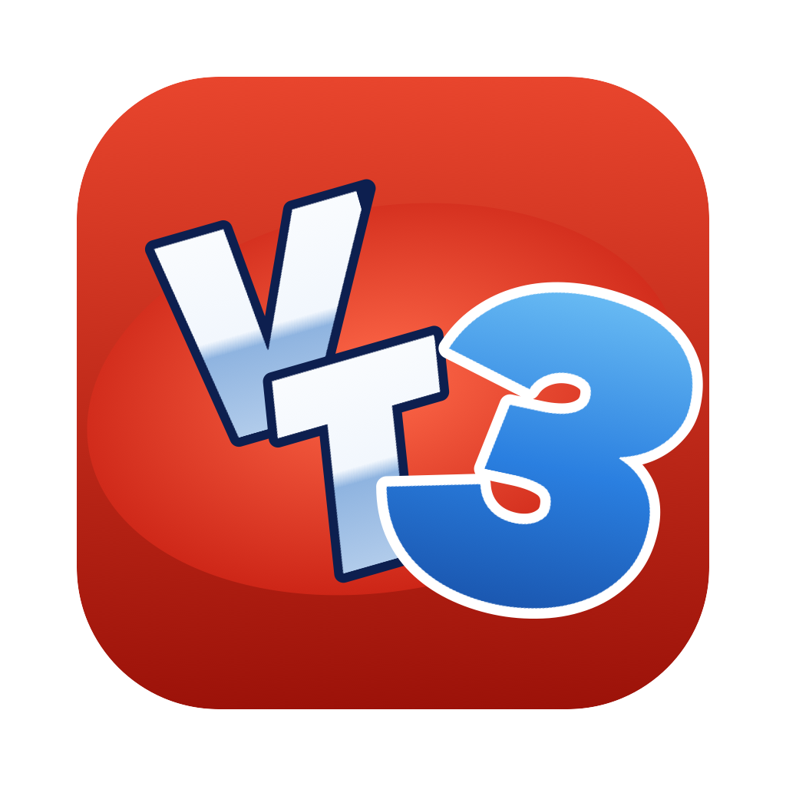
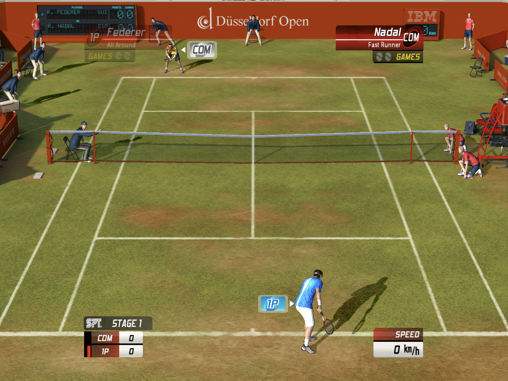

# Virtua Tennis 3 Port

  <a href="https://github.com/hjcoggan/vt3-port/releases/latest/download/VT3-Android.apk"><strong>DOWNLOAD THE ANDROID APK</strong></a>
  &nbsp;·&nbsp;
  <a href="https://github.com/hjcoggan/vt3-port/releases"><strong>RELEASES</strong></a>
  &nbsp;·&nbsp;
  <a href="https://github.com/hjcoggan/vt3-port/issues/new"><strong>REPORT A BUG</strong></a>

  

  

The PC release of Virtua Tennis 3 (SEGA, 2007) running as native code on Android and Apple Silicon
Macs through static recompilation. This is not an emulator and nothing runs under Wine.

It is an experimental developer build. It is playable on the Retroid Pocket (Snapdragon 8 Gen 2).
Vulkan is the default renderer on both platforms, with OpenGL as the fallback on the Mac.

No game files are included. You must provide your own copy of the game.

## Players: start here

1. [Download the latest Android APK](https://github.com/hjcoggan/vt3-port/releases/latest/download/VT3-Android.apk).
2. Copy two files onto the device:
   - a disc image of the **European PC DVD** (English, French, German, Spanish, Italian), e.g.
     `Virtua Tennis 3 (Europe) (En,Fr,De,Es,It).iso`
   - the English v1.0.1 no-CD zip, `Virtua-Tennis-3_NoCD_Win_EN_for-version-101.zip` (holds `VT3.exe`)

   | File | Size | SHA-256 |
   | --- | --- | --- |
   | European PC DVD image | 2,623,963,136 bytes | `10862f2a0c35cd0673b406331494f2482d107a4efab52aa6b7725a8c346e6165` |
   | v1.0.1 no-CD zip | 1,713,811 bytes | `0fdad05635c47da60ac18d3c6530b82b2f53bb6294913a036bfb342dcb80a943` |

   Only the European PC release has been tested. The USA PC release has not, and the installer
   rejects any `VT3.exe` other than the v1.0.1 no-CD one above.
3. Install the APK and open **VT3**.
4. Tap **Select PC disc image**, then **Select v1.0.1 NoCD**, then **Install**.
   Unpacking takes about a minute. Keep the app open.
5. The game starts. From then on, opening VT3 goes straight into the game.

Requirements: Android 10 or newer, ARM64, Vulkan, and about 4.5 GB free. Controllers work, and
on-screen touch controls appear on phones. Updating the APK keeps the installed game.
Uninstalling removes it.

## How it works

1. `tools/recomp/recomp.py` statically translates the x86 code of the v1.0.1 no-CD `VT3.exe` into C.
   Clang compiles that C for ARM64 (Android) or Apple Silicon (macOS).
2. A Win32, DirectSound and Direct3D 9 shim in plain C (`runtime/shim`) stands in for Windows.
   Direct3D 9 draws go to a Vulkan renderer, or to OpenGL on the Mac. The game's shader model 2
   shaders are translated to GLSL, and to a prebuilt SPIR-V pack for Vulkan.
3. SDL3 supplies the window, controllers, touch and audio.
4. On Android, a small launcher reads the disc image through the system file picker. It unpacks the
   InstallShield cabinets on the device (with [unshield](https://github.com/twogood/unshield)) and
   builds the guest image from `VT3.exe`, checking it against a known SHA-256. Everything stays in the
   app's own storage.

The repository holds no retail executables, assets or generated game code.

## Building

Developer notes, build commands and the current state of the port are in
[docs/HANDOFF.md](docs/HANDOFF.md).

- **macOS:** `tools/recomp/build_native.py` builds the game; `assets/macos/make_app.sh` bundles it as an `.app`.
- **Android:** CMake with the NDK builds `libvt3android.so`. `android/build_apk.py` then packages it
  with the launcher and the shader pack:
  `android/build_apk.py game vt3android --so libvt3android.so --asset shaders.pack`.

## Current status

- Boots, menus, tournaments and matches play on Mac and Android
- Native Vulkan rendering on both, with OpenGL as the fallback on the Mac
- Widescreen (Hor+) fill
- Controllers on both platforms, with on-screen touch controls on Android
- One-step install from your own disc image on Android

## More documentation

- [docs/recomp-design.md](docs/recomp-design.md): the recompiler
- [docs/d3d9-shaders.md](docs/d3d9-shaders.md): shader translation
- [docs/WIDESCREEN.md](docs/WIDESCREEN.md) and [docs/TOUCH_CONTROLS.md](docs/TOUCH_CONTROLS.md)
- [docs/formats.md](docs/formats.md): game data formats
- [docs/decisions.md](docs/decisions.md): decision log

## Legal

This repository contains no copyrighted game code or game data from Virtua Tennis 3: no
executables, assets, or code generated from them. A legitimately owned copy of the game is
required to play. Virtua Tennis 3 and all related trademarks and copyrights belong to SEGA
Corporation. This is an unofficial fan project and is not affiliated with or endorsed by SEGA.
